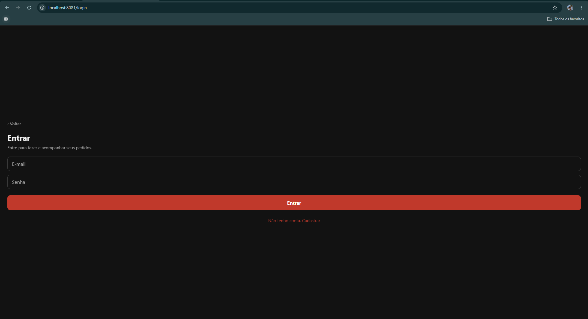
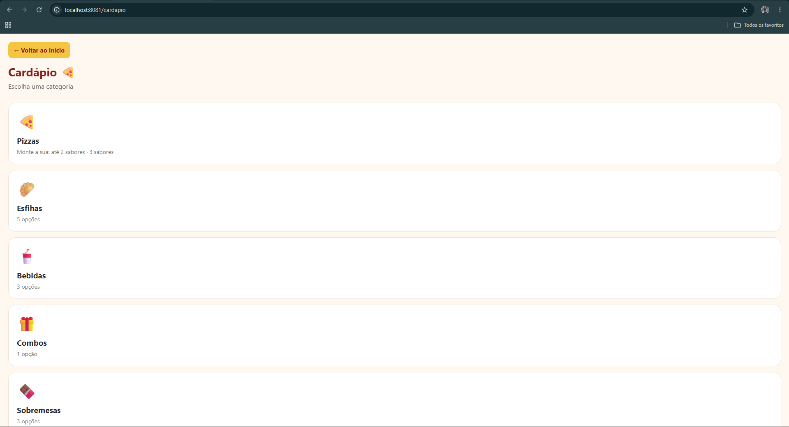
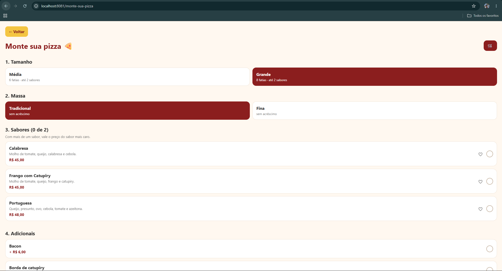
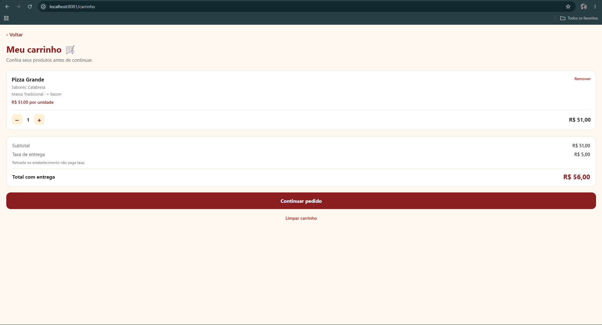
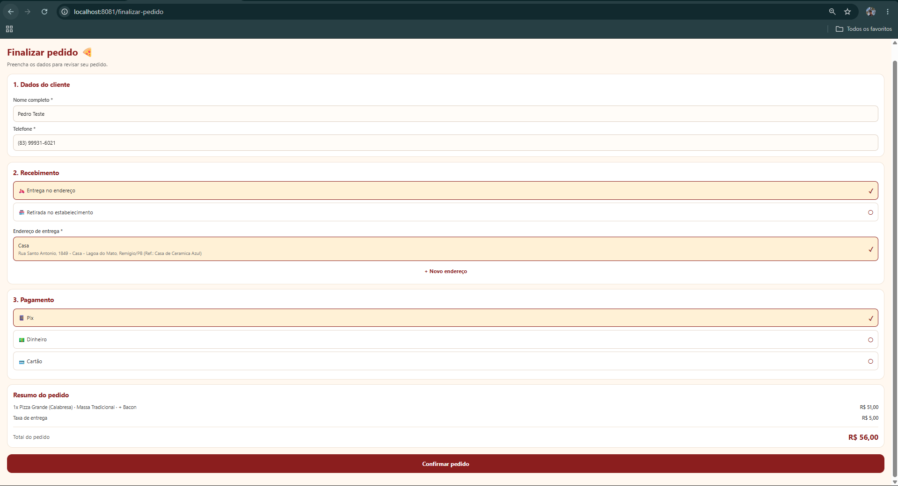
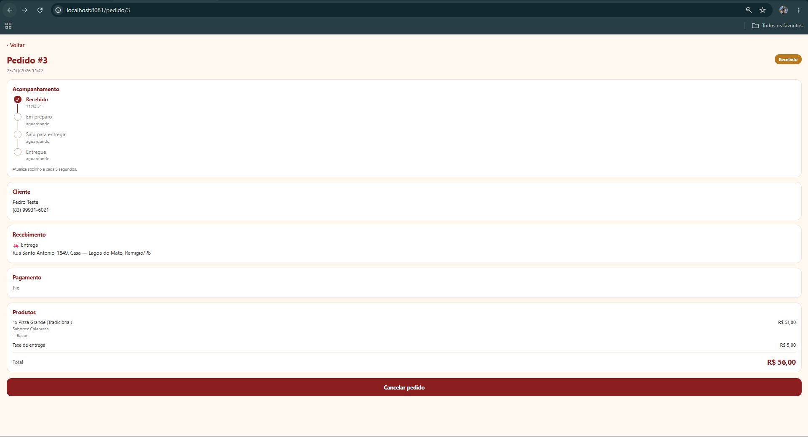
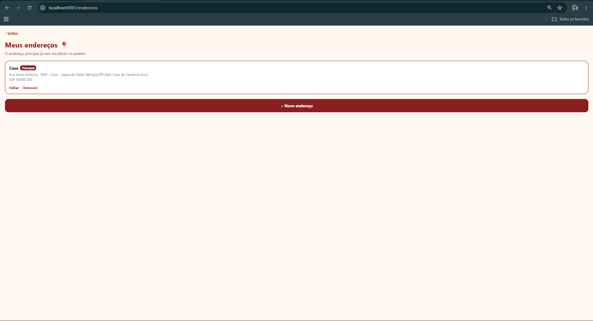

# 🍕 Sabor da Gente

Aplicativo mobile de pizzaria feito em **React Native + Expo + TypeScript** para a disciplina de **Programação para Dispositivos Móveis (PDM)**.
O cliente vê o cardápio, monta a pizza, faz o pedido e acompanha o status. O painel da pizzaria (projeto web de DAW III) usa o mesmo banco, e **os dois conversam pelo Supabase**.

## 🎯 Tema

Pedidos de pizzaria. **Entidade principal:** `Pedido`, com itens, endereço e pagamento. Há também produtos, pizza montável (tamanho, massa, sabores e adicionais), carrinho, favoritos, endereços e perfil.

## ✨ Funcionalidades

- Cadastro e login (Supabase Auth); nome e telefone entram no perfil
- Cardápio por categoria, com produtos sincronizados do painel web
- "Monte sua pizza": tamanho, massa, 1 ou 2 sabores e adicionais
- Carrinho que não se perde ao fechar o app
- Endereços (criar, editar, principal, remover) e perfil
- Finalizar pedido (entrega ou retirada; Pix, cartão ou dinheiro com troco)
- Acompanhamento do pedido, atualizado a cada 5 s, e cancelamento enquanto "Recebido"
- Histórico de pedidos e favoritos

## 🛠️ Tecnologias

- React Native, Expo SDK 57 e Expo Router
- TypeScript
- SQLite local (`expo-sqlite`) para cardápio, carrinho e favoritos
- Supabase (Auth + PostgreSQL) para conta, perfil, endereços e pedidos

## 🧠 Persistência e justificativa

| Dado | Onde fica | Por quê |
|---|---|---|
| Cardápio, carrinho, favoritos | **SQLite no celular** | continuam após fechar o app; carrinho e cardápio funcionam sem internet |
| Conta, perfil, endereços, pedidos | **Supabase (nuvem)** | o painel web precisa ver os pedidos e mudar o status |
| Produtos do painel | Supabase → SQLite | ao abrir o cardápio, o app baixa os produtos e atualiza o SQLite; sem internet usa o último cardápio |

Decisões:

- **Repositórios:** as telas nunca escrevem SQL nem chamam o Supabase; usam interfaces em `src/repositories` (implementações `sqlite/` e `supabase/`). A escolha fica em `src/hooks/use-repositorios.ts`.
- **Preço do pedido é calculado no banco** (função `criar_pedido`); o app envia só IDs e quantidades.
- **Dinheiro em centavos** (inteiros), sem erro de arredondamento.
- **SQL seguro:** valores sempre por parâmetro (`?`).
- **Versão do banco local** controlada por `PRAGMA user_version` (`src/database`).
- O número do pedido (`pedidos.numero`) é o identificador usado no app.

## ▶️ Como executar

    git clone https://github.com/Sabor-da-Gente/mobile-sabor-da-gente.git
    cd mobile-sabor-da-gente
    npm install
    npx expo start

Abra no celular com o **Expo Go** (QR code) ou em um emulador Android. O arquivo `.env` já vem no repositório com a URL do projeto e a *publishable key* do Supabase (chave pública). Para fazer pedidos é preciso estar logado: Perfil → Entrar ou cadastrar.

Para ver o pedido chegar ao painel, rode também o projeto web (`sabor--da-gente-web`).

## 📸 Telas

## 🗃️ Estrutura

    src/app/            telas (Expo Router)
    src/components/     componentes
    src/context/        autenticação, carrinho e favoritos
    src/models/         classes de domínio
    src/repositories/   interfaces + sqlite/ + supabase/ (camada de dados)
    src/services/       regras de preço e cliente do Supabase
    src/database/       schema, migrações e seed do SQLite

## 🔗 Projetos relacionados

- Banco (Supabase): [`api-sabor-da-gente`](https://github.com/Sabor-da-Gente/api-sabor-da-gente)
- Painel web: [`sabor--da-gente-web`](https://github.com/Sabor-da-Gente/sabor--da-gente-web)
