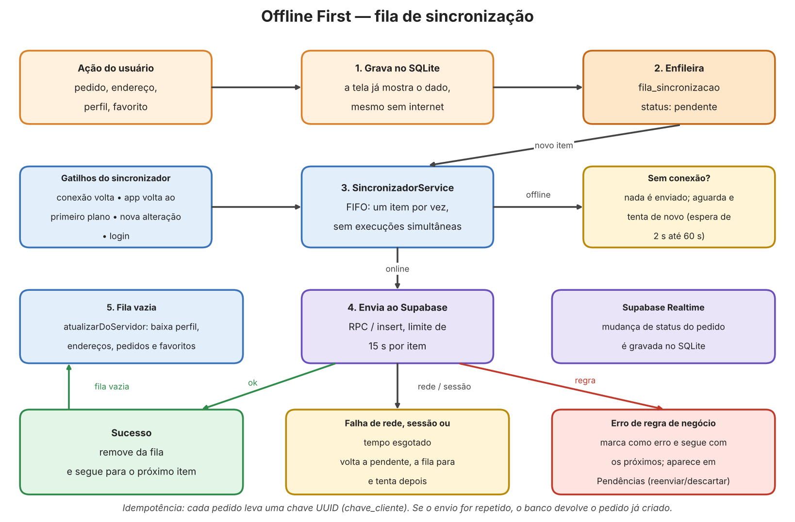
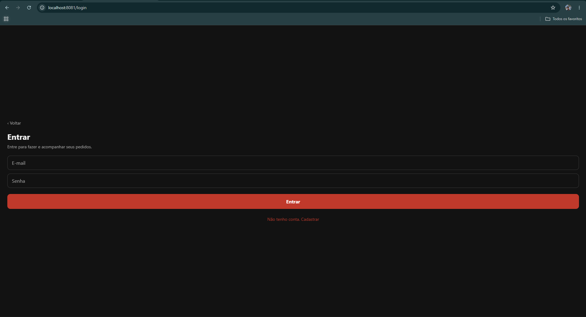
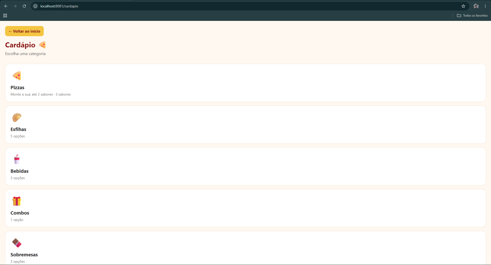
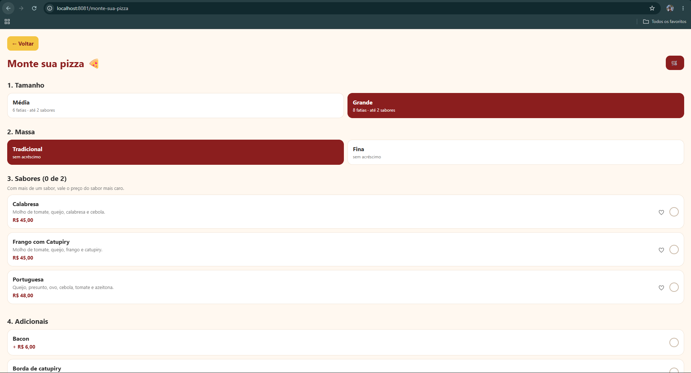
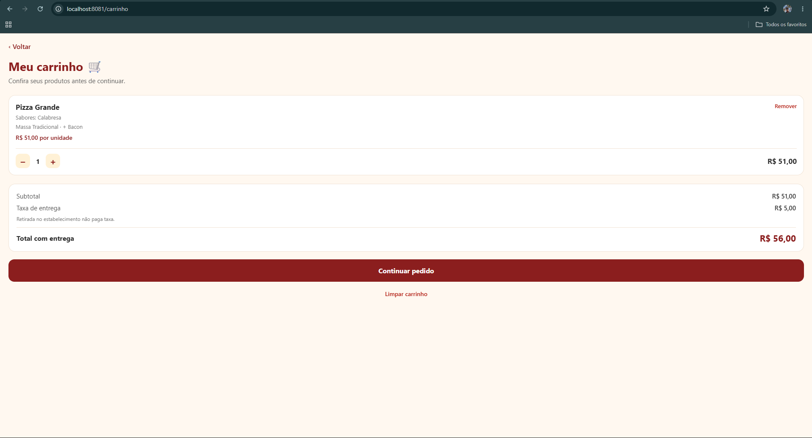
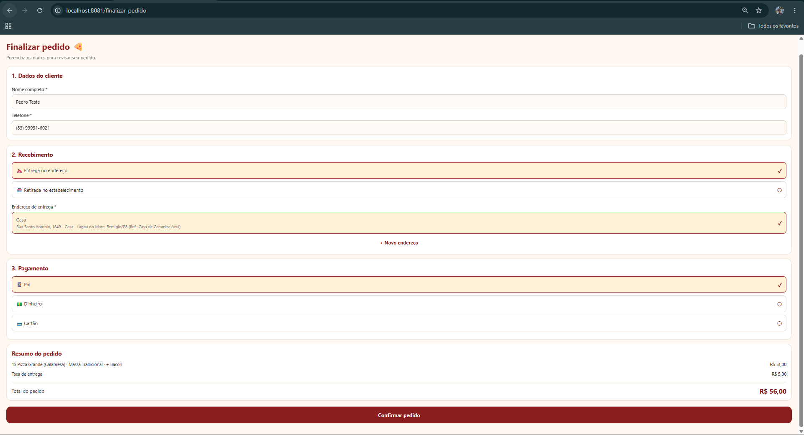
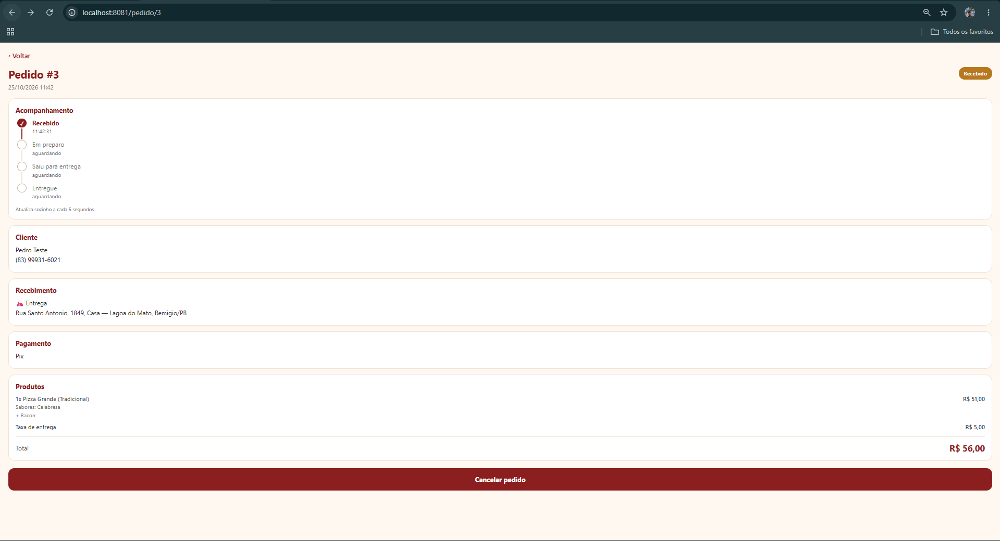
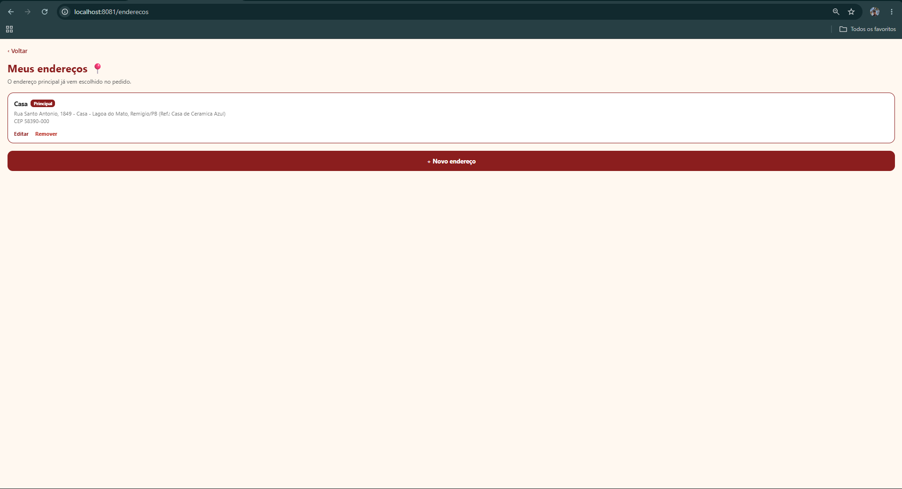
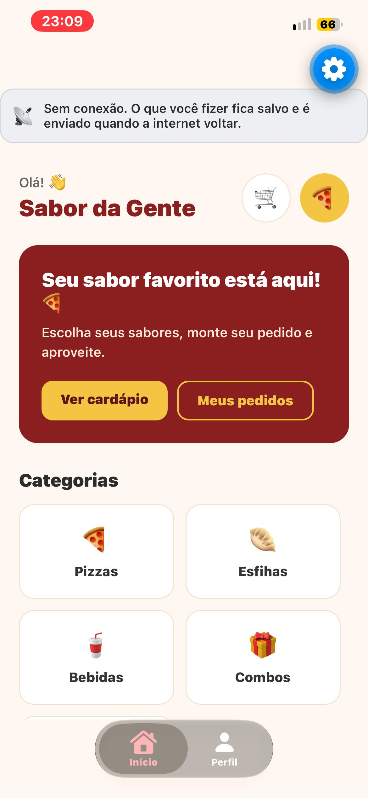
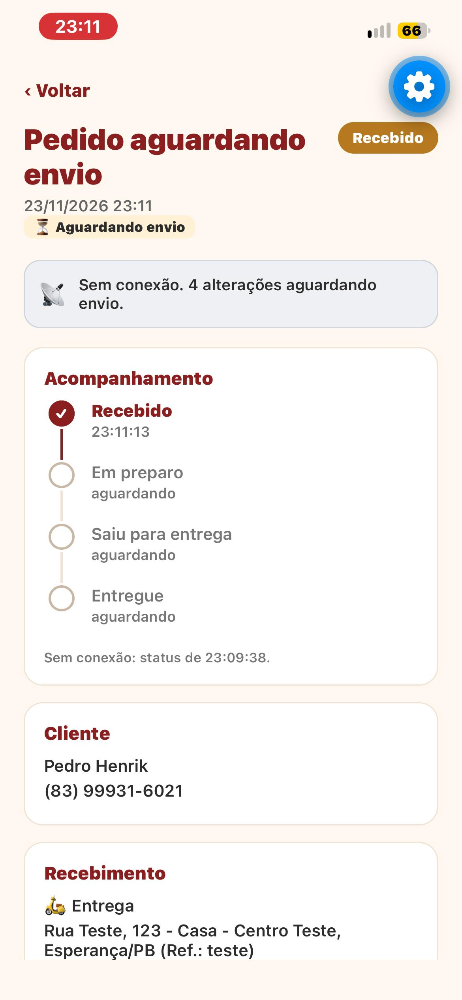

# 🍕 Sabor da Gente

Aplicativo mobile de pizzaria feito em **React Native + Expo + TypeScript** para a disciplina de **Programação para Dispositivos Móveis (PDM)**.
O cliente vê o cardápio, monta a pizza, faz o pedido e acompanha o status. O painel da pizzaria (projeto web de DAW III) usa o mesmo banco, e **os dois conversam pelo Supabase**.

## 🎯 Tema

Pedidos de pizzaria. **Entidade principal:** `Pedido`, com itens, endereço e pagamento. Há também produtos, pizza montável (tamanho, massa, sabores e adicionais), carrinho, favoritos, endereços e perfil.

## ✨ Funcionalidades

- Cadastro e login (Supabase Auth); nome e telefone entram no perfil
- Cardápio por categoria, com produtos sincronizados do painel web
- "Monte sua pizza": tamanho, massa, 1 ou 2 sabores e adicionais
- Carrinho que não se perde ao fechar o app
- Endereços (criar, editar, principal, remover) e perfil
- Finalizar pedido (entrega ou retirada; Pix, cartão ou dinheiro com troco)
- Acompanhamento do pedido em tempo real (Supabase Realtime) e cancelamento enquanto "Recebido"
- Histórico de pedidos e favoritos
- **Funciona sem internet (Offline First):** pedidos, endereços, perfil e favoritos são salvos no aparelho e enviados ao servidor quando a conexão volta

## 🛠️ Tecnologias

- React Native, Expo SDK 58 e Expo Router
- TypeScript
- SQLite local (`expo-sqlite`) para os dados do app e para a fila de sincronização
- `expo-network` para detectar a conexão e `expo-crypto` para gerar a chave única de cada pedido
- Supabase (Auth + PostgreSQL + Realtime) para conta, perfil, endereços, pedidos e favoritos

## 🧠 Persistência e justificativa

| Dado | Onde fica | Por quê |
|---|---|---|
| Cardápio | Supabase → SQLite | ao abrir o app, os produtos do painel são baixados para o SQLite; sem internet usa o último cardápio salvo |
| Carrinho | **SQLite no celular** | continua após fechar o app e funciona sem internet |
| Perfil, endereços, pedidos, favoritos | **SQLite primeiro**, depois Supabase | toda alteração é gravada no aparelho e entra na fila; o servidor recebe quando houver conexão e o painel web passa a ver o pedido |
| Fila de sincronização | **SQLite** (`fila_sincronizacao`) | as alterações pendentes sobrevivem ao fechamento do app |
| Conta (login e cadastro) | **Supabase Auth** | exige internet; com a sessão salva o app continua usável offline |

Decisões:

- **Repositórios:** as telas nunca escrevem SQL nem chamam o Supabase; usam interfaces em `src/repositories` (implementações `sqlite/`, `supabase/` e `offline/`). A escolha fica em `src/hooks/use-repositorios.ts`.
- **Preço do pedido é calculado no banco** (função `criar_pedido`); o app envia só IDs e quantidades. Offline, a tela mostra um total estimado, que é substituído pelo valor do servidor.
- **Dinheiro em centavos** (inteiros), sem erro de arredondamento.
- **SQL seguro:** valores sempre por parâmetro (`?`).
- **Versão do banco local** controlada por `PRAGMA user_version` (`src/database`), hoje na versão 4.
- O número do pedido (`pedidos.numero`) é o identificador usado no app.

## 📴 Offline first

O app segue a regra: **toda alteração é feita primeiro no SQLite e só depois enviada ao servidor**. Sem internet, o usuário continua usando o app normalmente, e tudo é sincronizado quando a conexão volta.

### Escrita local e fila

1. A ação do usuário (fazer pedido, criar ou editar endereço, salvar perfil, favoritar, cancelar pedido) é gravada no SQLite, e a tela já mostra o resultado.
2. Uma operação correspondente entra na tabela `fila_sincronizacao`, com o usuário, o nome da operação, os dados em JSON e o status (`pendente`, `enviando` ou `erro`).
3. A fila é **FIFO**: os itens são enviados na ordem em que foram criados. Assim, um endereço criado offline chega antes do pedido que depende dele, e dois pedidos feitos offline chegam ao painel na ordem certa.
4. Cada usuário tem a sua fila (`usuario_id`): outra conta no mesmo aparelho não vê nem envia as alterações da anterior.

### Sincronizador

O `SincronizadorService` processa a fila, um item por vez, e nunca roda duas sincronizações ao mesmo tempo. Ele é disparado quando:

- a conexão volta (`expo-network`);
- o app volta ao primeiro plano;
- uma nova alteração entra na fila;
- o usuário faz login;
- o app é aberto.

Cada envio tem limite de 15 s. Se a fila parar por falha de conexão, o sincronizador tenta de novo sozinho, com espera crescente (de 2 s até 60 s). Itens que ficaram como "enviando" quando o app foi fechado voltam a "pendente" na próxima abertura, então nada se perde.

### Leitura dos dados

As telas leem **sempre do SQLite**. Quando a fila esvazia, o app baixa do servidor perfil, endereços, pedidos e favoritos e atualiza o banco local. O status do pedido chega em tempo real: o app assina o Supabase Realtime nos pedidos do cliente e grava cada mudança no SQLite. Sem conexão, o app mostra o último dado conhecido.

### Idempotência

Se a conexão cair no meio do envio, o app pode não receber a resposta e reenviar o pedido. Para não duplicar:

- cada pedido recebe uma chave UUID (`chave_cliente`), gerada **uma única vez** quando o pedido é criado;
- a chave é enviada à função `criar_pedido` (parâmetro `p_chave_cliente`);
- o banco tem índice único em `(cliente_id, chave_cliente)`: se a mesma chave chegar de novo, ele **devolve o pedido já criado** em vez de criar outro.

### Tratamento de erros

| Situação | O que o app faz |
|---|---|
| Sem conexão, erro de rede, sessão expirada ou servidor lento | O item volta a `pendente`, a fila para e uma nova tentativa é agendada |
| Erro de regra de negócio (por exemplo, produto desativado no painel) | O item vira `erro` e **a fila continua** com os próximos itens; o usuário vê o aviso e pode reenviar ou descartar na tela **Pendências** |
| Erro inesperado | Até 5 tentativas; depois o item vira `erro` |
| Operação desconhecida | O item vira `erro` |

### Aviso na interface

Uma faixa no app informa o estado da sincronização:

- **Sem conexão:** mostra quantas alterações aguardam envio;
- **Enviando:** mostra as alterações em andamento;
- **Erro:** avisa que alterações não puderam ser enviadas e leva à tela **Pendências**.

Pedidos ainda não enviados aparecem com o selo "aguardando envio". Ao sair da conta com alterações pendentes, o app oferece **sincronizar agora**, **sair e descartar** ou **cancelar**.

### Limitações

- **Login e cadastro exigem internet.** Com a sessão já salva, o app funciona offline.
- O total de um pedido feito offline é uma **estimativa**: o valor final é calculado pelo banco e pode ser diferente.
- Pedidos criados offline só aparecem no painel web depois da sincronização.

O roteiro completo de testes está em [`docs/testes-offline.md`](docs/testes-offline.md).

## ▶️ Como executar

    git clone https://github.com/Sabor-da-Gente/mobile-sabor-da-gente.git
    cd mobile-sabor-da-gente
    npm install
    npx expo start

Abra no celular com o **Expo Go** (QR code) ou em um emulador Android. O arquivo `.env` já vem no repositório com a URL do projeto e a *publishable key* do Supabase (chave pública). Para fazer pedidos é preciso estar logado: Perfil → Entrar ou cadastrar.

Para ver o pedido chegar ao painel, rode também o projeto web (`sabor--da-gente-web`).

## 📸 Telas

### Offline first

Aviso de que o app está sem conexão, com as alterações aguardando envio:

Pedido feito offline com o selo "aguardando envio":

Erro de envio, com a opção de ver as pendências:

Pedido feito offline aparecendo no painel quando a conexão volta:

## 🗃️ Estrutura

    src/app/                      telas (Expo Router), incluindo Pendências
    src/components/               componentes (aviso de conexão, etc.)
    src/context/                  autenticação, carrinho, favoritos e sincronização
    src/hooks/                    repositórios, conexão e saída da conta
    src/models/                   classes de domínio
    src/repositories/             interfaces + sqlite/ + supabase/ + offline/ (camada de dados)
    src/services/                 regras de preço, cliente do Supabase e conexão
    src/services/sincronizacao/   fila, sincronizador, atualização do servidor e Realtime
    src/database/                 schema, migrações e seed do SQLite
    docs/                         diagrama da fila, roteiro de testes e prints

## 🔗 Projetos relacionados

- Banco (Supabase): [`api-sabor-da-gente`](https://github.com/Sabor-da-Gente/api-sabor-da-gente)
- Painel web: [`sabor--da-gente-web`](https://github.com/Sabor-da-Gente/sabor--da-gente-web)
